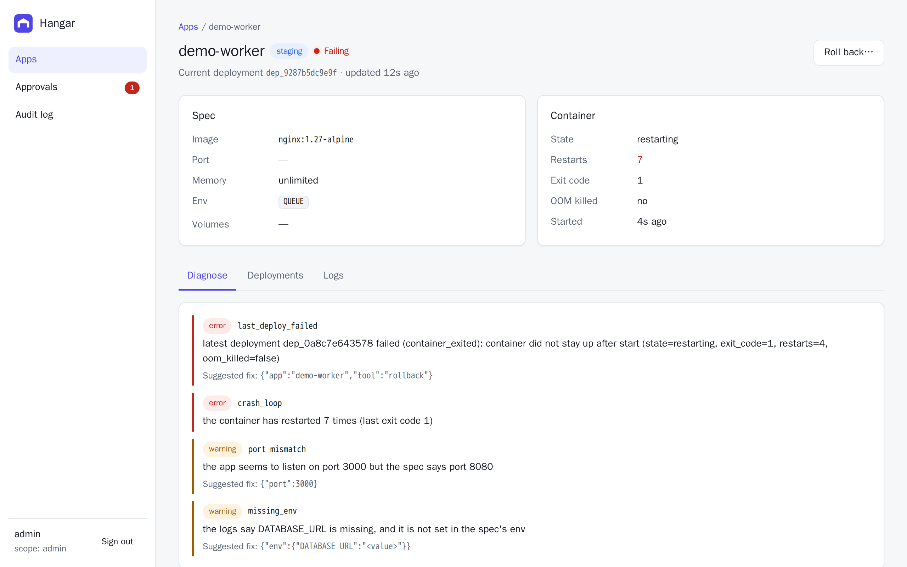
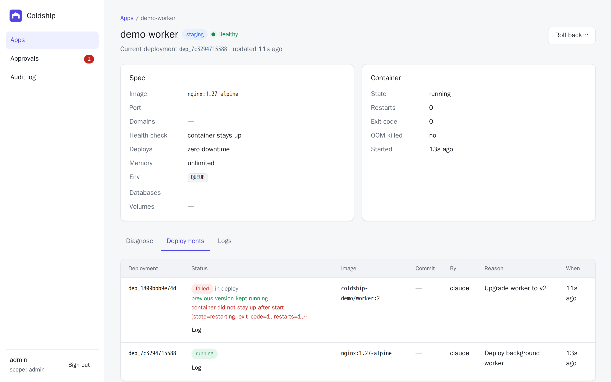

## Diagnose

`diagnose` is the first call to make when something is wrong. In one response, sized to fit an agent's context, it returns:

- the container's state, exit code, restart count and whether it was killed for running out of memory
- the latest deployment and its error, if it failed
- the last 50 log lines (marked untrusted)
- the end of the deploy log (build output, health checks, the failed container's output), if the latest deployment failed
- **findings**: likely causes, each with a severity, a code and often a suggested fix

```sh
hangar diagnose worker
```

```txt
App demo-worker: healthy=false state=restarting restarts=5
  [error] last_deploy_failed: latest deployment dep_832572d5f155 failed (container_exited): container did not stay up after start ...
      suggested fix: {"app":"demo-worker","tool":"rollback"}
  [error] crash_loop: the container has restarted 5 times (last exit code 1)
  [warning] port_mismatch: the app seems to listen on port 3000 but the spec says port 8080
      suggested fix: {"port":3000}
  [warning] missing_env: the logs say DATABASE_URL is missing, and it is not set in the spec's env
      suggested fix: {"env":{"DATABASE_URL":"<value>"}}
```



### Findings

| Code | Severity | Detected when |
|---|---|---|
| `last_deploy_failed` | error | The newest deployment failed after its container was replaced |
| `build_failed` | warning | The newest deployment failed to build. The previous version is still running |
| `new_version_unhealthy` | warning | The newest deployment never passed its health check, so traffic stayed on the previous version. Log checks (port mismatch, missing env) run against the failed container's captured output |
| `proxy_down` | error | The app has domains but the `hangar-proxy` container isn't running |
| `not_running` | error | No container exists for the app |
| `oom_killed` | error | The container was killed for running out of memory. The fix doubles `memory` |
| `crash_loop` | error | More than 2 restarts |
| `exited` | error | The container is stopped |
| `port_mismatch` | warning | Logs show the app listening on a different port than `port` in the spec |
| `missing_env` | warning | A log line about a missing value names an UPPER_CASE variable that isn't in `env` |
| `address_in_use` | error | Logs report `EADDRINUSE` or "address already in use" |
| `permission_denied` | warning | Logs report permission errors |
| `healthy` | info | None of the above |

When the latest deploy failed, the log checks compare against the **failed** deployment's spec, since that's the one whose container wrote the logs.

## Rollback

```sh
hangar rollback worker --reason "v2 crash-loops on missing DATABASE_URL"
hangar rollback worker --to dep_9315b046feec --reason "go back to the March release"
```

Without `--to`, rollback picks the last good deployment:

- If the **latest deploy failed**, it redeploys the current (last successful) deployment. A failed deploy may have left a broken container running, so this brings the app back.
- Otherwise, it redeploys the most recent **superseded** deployment, meaning the one before the current one.

A rollback is an ordinary plan plus apply under the hood, so it is audited, checked for staleness and subject to approval. Rolling back across a volume removal on a production app, for example, still needs a human.


