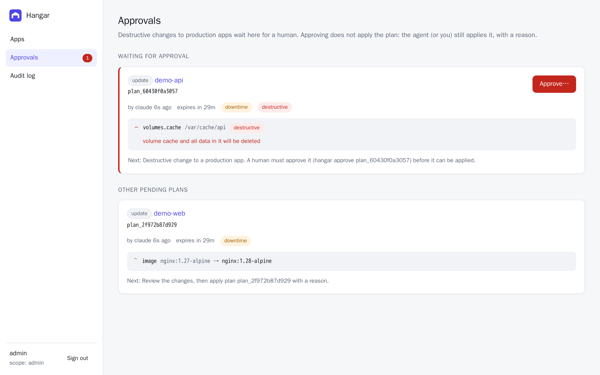
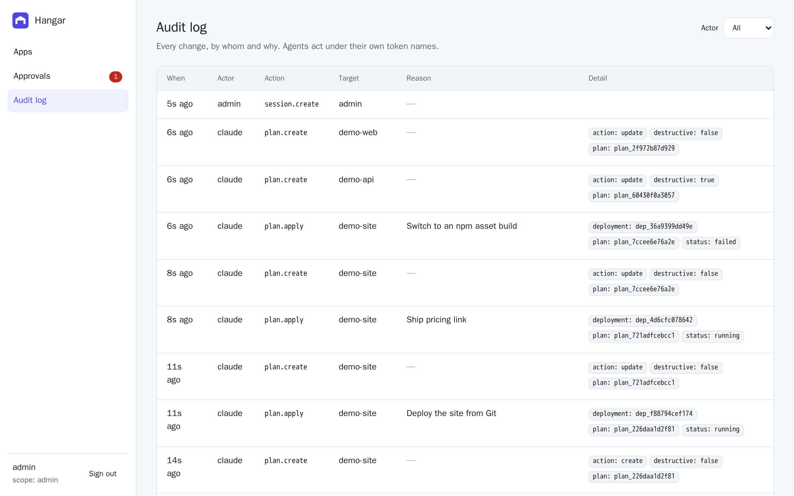

Hangar assumes an agent will eventually try something it shouldn't, whether by mistake or because something in its context told it to. These guardrails limit what that can cost you.

## Scoped tokens

Every request carries a bearer token, and every token has one scope:

| Scope | Can |
|---|---|
| `read` | List and inspect apps, plans, deployments, logs, diagnose, the audit log |
| `deploy` | Everything in `read`, plus create plans, apply plans and roll back |
| `admin` | Everything in `deploy`, plus approve plans and create tokens |

Give each agent its own `deploy` token, so its actions are attributed to it in the audit log:

```sh
hangar token create --name claude --scope deploy
```

Admin tokens are for humans. The first one is created when the server first starts.

## Approval for destructive production changes

A plan needs approval when it is **destructive** and the app's stage is **production**, either before or after the change. That second condition means an agent can't get around approval by demoting an app to `staging` in the same plan.

```txt
Plan plan_0a2136c9ac8b for app "api" (update)
  - volumes.cache (was /var/cache/api)  [DESTRUCTIVE: volume cache and all data in it will be deleted]
Destructive: yes  Downtime: yes  Requires approval: yes
Next: Destructive change to a production app. A human must approve it (hangar approve plan_0a2136c9ac8b) before it can be applied.
```

A human approves from the CLI (`hangar approve <plan-id>`) or the [dashboard](/guides/dashboard/). The MCP server has no approve tool at all.

Approving doesn't apply the plan. The agent, or you, still applies it with a reason, so there are two separate, attributable steps.



## Secrets are write-only

Env values go into the spec but never come back out. API responses, plans, CLI output, MCP results and the dashboard all show `<redacted>`. The runtime passes values to Docker through a file readable only by its owner, never on the command line where other processes could see them.

## Logs are untrusted

Application logs and build logs can contain anything, including text written to look like instructions for an agent. Every logs, build-log and diagnose response carries `"untrusted": true` or a note saying so, and the MCP tool descriptions repeat the warning.

## Dashboard sessions

The dashboard never stores a token in the browser. Signing in exchanges the token for a 12-hour session in an `HttpOnly`, `SameSite=Strict` cookie that page scripts can't read. Requests that change state also need an `X-Hangar-Request` header, which a forged cross-site request can't send. Signing out deletes the session on the server.

## Audit log

Every mutation is recorded with the actor (the token name), the action, the target and the reason:

```sh
hangar audit
```


