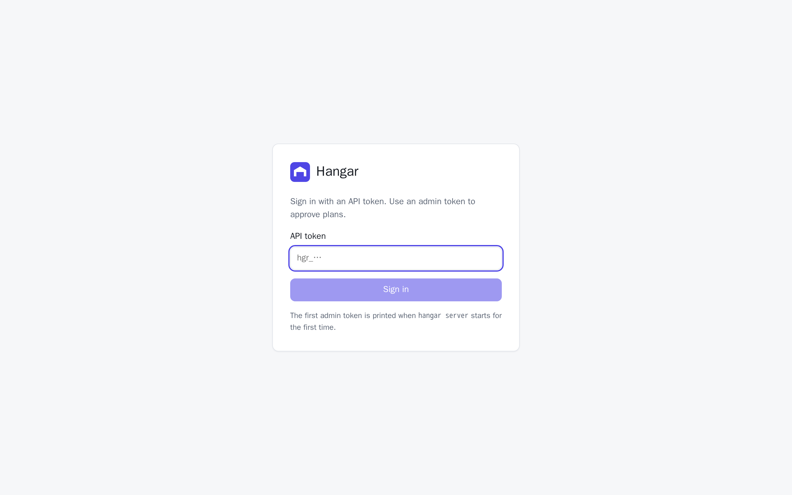

import { Steps, Aside } from '@astrojs/starlight/components'

## Requirements

- A Linux server with systemd (Ubuntu, Debian, Fedora, RHEL, Oracle Linux, …). Docker is installed for you if it's missing.
- To build from source only: Go 1.26+ and [Bun](https://bun.sh)

## Run it

<Steps>

1. **Install it on your server.**

   ```sh
   curl -fsSL https://raw.githubusercontent.com/dunkbing/coldship/main/install.sh | sh
   ```

   It asks for sudo, installs Docker if it's missing, runs Coldship as a service that starts on boot, and logs your CLI in, so `coldship` commands work right away. At the end it prints your **admin token** once: keep it in a password manager for the dashboard and other machines.

   On macOS, or with `COLDSHIP_CLI_ONLY=1`, it installs only the CLI. Connect that to a server with `coldship login https://your-server`.

2. **Open the dashboard** (optional). It listens on `127.0.0.1:7070` on the server. From your laptop, open a tunnel with `ssh -L 7070:127.0.0.1:7070 your-server`, browse to [http://localhost:7070](http://localhost:7070), and sign in with the admin token.

3. **Deploy an app.** No config file needed:

   ```sh
   coldship deploy --name hello --image nginx:1.27-alpine --port 80 --host-port 8080
   curl http://127.0.0.1:8080
   ```

   Or, inside one of your Git repositories, just:

   ```sh
   coldship deploy --domain hello.example.com
   ```

   Coldship names the app after the folder, builds your current branch (with or without a Dockerfile) and serves it on the domain with HTTPS.

4. **Change it.** Flags change only what they name; everything else, secrets included, stays:

   ```sh
   coldship deploy --name hello --env GREETING=hi --db postgres
   ```


</Steps>



## Next steps

- [Connect an AI agent](/guides/ai-agents/) with its own deploy-scoped token.
- Learn how [approvals](/concepts/plan-and-apply/) keep agents from breaking production.
- Prefer config in Git? `coldship export hello > coldship.yaml` writes the [spec](/reference/spec/), and `coldship deploy -f coldship.yaml` deploys it.

<Aside type="caution">
  The server binds to localhost by default. Before exposing it on a network, read [Running in production](/guides/production/).
</Aside>
