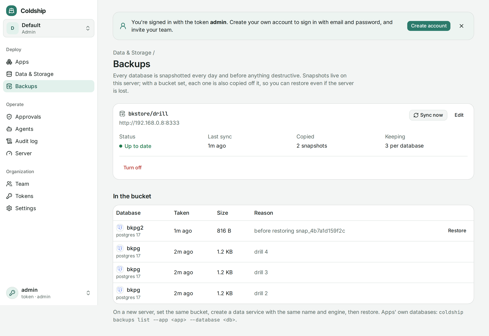

Coldship [snapshots every database](/guides/databases/#snapshots) daily and before anything destructive. Those snapshots live on the server's disk, so a lost disk loses them too. Set a bucket, and Coldship copies each snapshot off the server as soon as it's taken.



## Setting a bucket

Any S3-compatible storage works: AWS S3, Cloudflare R2, Backblaze B2, Wasabi, or your own MinIO, RustFS or SeaweedFS (on another server). Create a bucket with encryption turned on, and keys that can list, read, write and delete objects in it.

In the dashboard, open **Backups** (under Deploy, or from Data & Storage), click **Set a bucket**, and fill in the endpoint, bucket, keys and, if the provider needs it, the region. Turn on **Path-style URLs** for MinIO, RustFS, SeaweedFS and other self-hosted S3. Coldship writes, lists and deletes a test file before saving, so a typo fails right away instead of at 3 a.m.

From the CLI (an admin token), with the secret key in the environment so it never lands in your shell history:

```sh
COLDSHIP_BACKUP_SECRET_KEY=... coldship backups set \
  --endpoint https://s3.us-east-1.amazonaws.com --region us-east-1 \
  --bucket my-backups --access-key AKIA...
```

Snapshots already on the server are copied first. After that, each new snapshot is copied within a minute; failures are retried every 10 minutes and shown on the Backups page and in `coldship backups`.

The secret key is stored encrypted and never shown again. To change other settings, edit and leave the secret empty to keep it.

## What's in the bucket

Under the folder you chose (`coldship/` by default):

```
coldship/data/<service>/<time>-<snapshot>.dump        a data service's snapshot
coldship/apps/<app>/<database>/<time>-<snapshot>.dump an app database's snapshot
….dump.json                                            its manifest
```

Each manifest records the engine, version, size and SHA-256 of its dump, so a bucket alone is enough to restore. Coldship keeps the newest 30 backups per database (**Keep** in the form, `--keep` on the CLI) and deletes older ones. It only ever deletes its own files, and never deletes the backups of a database that has since been deleted.

Backups are not encrypted by Coldship: use the bucket's encryption. A key that lived only on the server would die with it, taking the backups with it.

## Restoring

On a data service's page, **Off-site backups** lists its backups; **Restore** replaces its data with one. Like any restore, the backup is checked against its checksum first, and the current data is snapshotted before it's replaced.

```sh
coldship backups list --data maindb
coldship data restore maindb --backup coldship/data/maindb/20261102T030000.000000000Z-snap_1a2b3c.dump --reason "bad migration"
```

A backup restores into any data service with the same engine and the same or a newer major version: Postgres 16 backups load into Postgres 17, not the other way around.

### On a new server

1. Install Coldship and set the same bucket, folder and keys.
2. Create the data services again, with the same names and engines.
3. On **Backups**, their backups now have a **Restore** button.

For an app's own databases (declared in its spec), deploy the app, then copy the backup in and restore it:

```sh
coldship backups list --app shop --database main
coldship db import shop main --backup coldship/apps/shop/main/…   # prints a snapshot id
coldship db restore shop main <snapshot> --reason "new server"
```

## Organizations

Each [organization](/guides/organizations/) sets its own bucket and sees only its own backups. Organizations other than the default one can only use public HTTPS endpoints, so their admins can't point Coldship at the server's own network.

## Agents

Agents see backup status and the list of backups with the `coldship_backups` MCP tool, and take snapshots before risky changes with `coldship_snapshot_data`. Restoring, and changing the bucket, need an admin.
