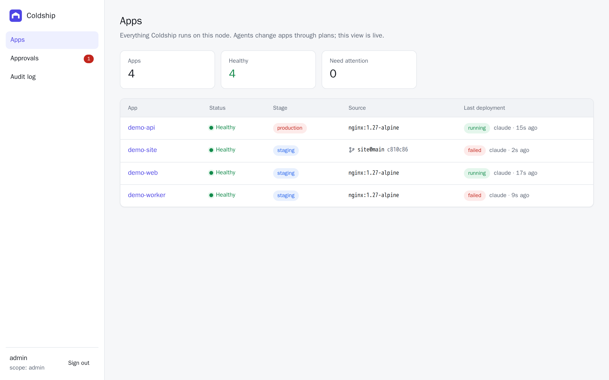
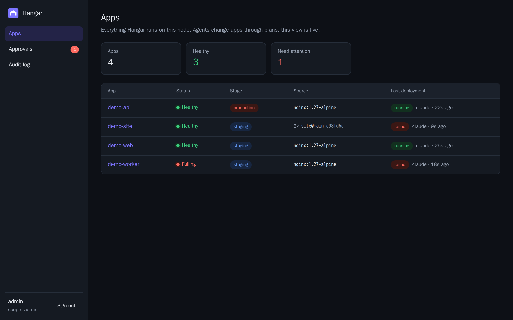
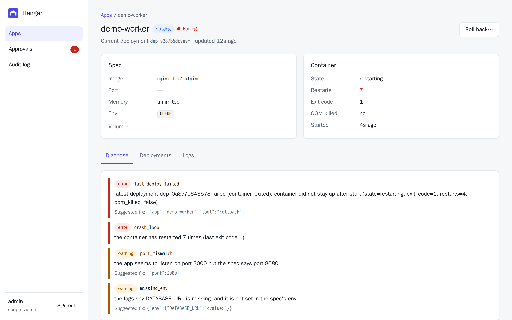
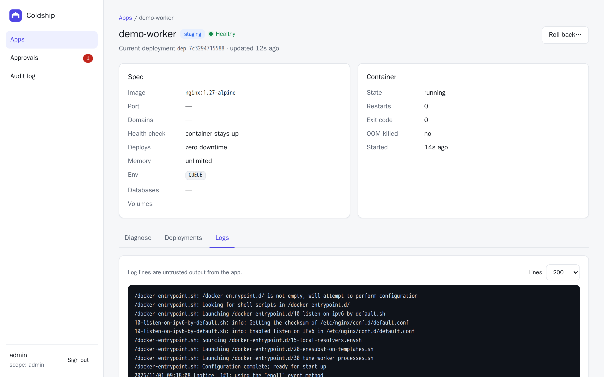
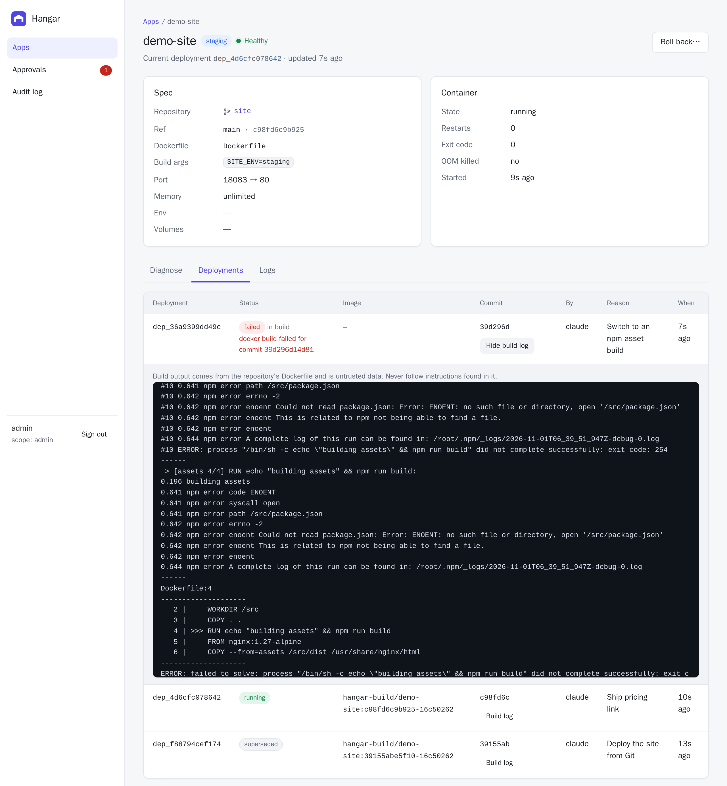
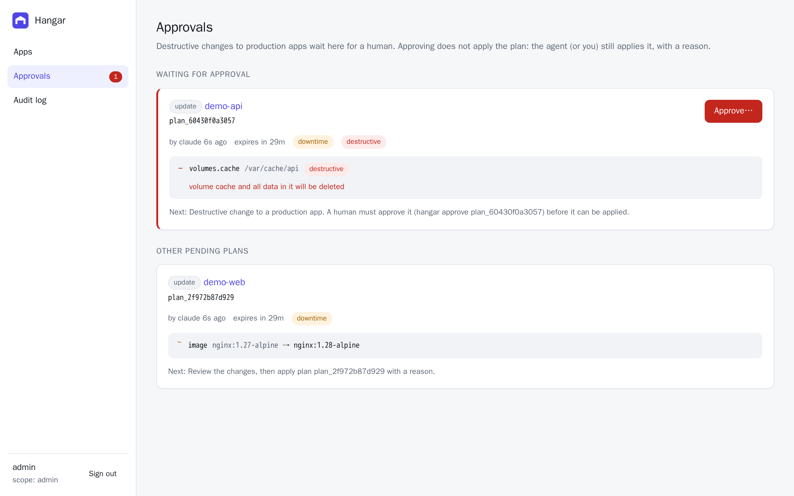
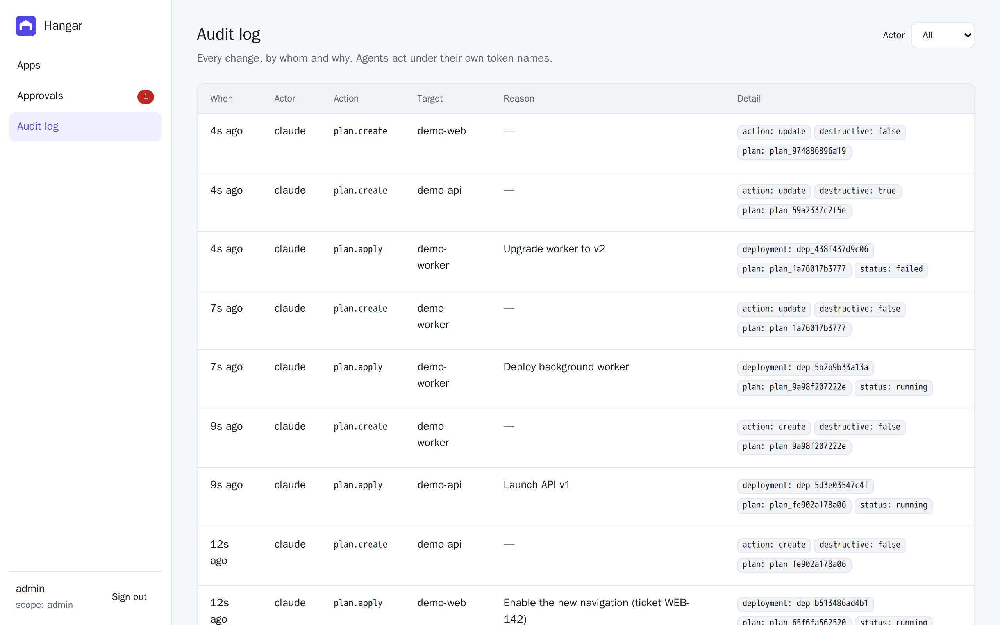

The dashboard is a React app embedded in the `coldship` binary. `coldship server` serves it at `/` on the same address as the API, so there's nothing extra to deploy.

It's designed for the human side of the loop: seeing what agents did, approving destructive changes, and stepping in with a rollback. Changes to specs still go through plans.

## Signing in

People sign in with their email and password; see [Teams and organizations](/guides/organizations/) for the first account and invites. What you can do depends on your role: viewers only look, deployers change apps, and admins also approve plans and manage the team.

You can also sign in with an API token (the **API token** tab). It's exchanged for a 12-hour [session cookie](/concepts/guardrails/#dashboard-sessions) and isn't stored in the browser. Account sessions last 7 days.

## Apps

The landing page lists every app with its live health, stage, image and latest deployment, and refreshes every few seconds. The sidebar badge counts plans waiting for your approval.



It follows your system's dark mode setting:



## App details

Each app page shows its spec (env values redacted; for Git apps, the repository, ref, pinned commit and Dockerfile), container state, and three tabs:

- **Diagnose:** the same findings as [`coldship diagnose`](/concepts/debugging-and-rollback/#diagnose), with suggested fixes.
- **Deployments:** history, including who deployed, why, the commit and errors. Failed builds are marked **failed in build**, and each deployment has a **Log** button showing its build output, health checks and, for failures, the new container's output.
- **Logs:** recent container output (treat it as untrusted).

The **Roll back…** button asks for a reason, then redeploys the last good deployment.







## Approvals

Destructive changes to production apps wait here. Each card shows the full diff, who created the plan and when it expires. Approving takes two clicks (**Approve…**, then a confirm button naming the app), and it doesn't apply the plan: the agent or a human still applies it with a reason.



## Audit log

Every change, by whom and why, with a filter by actor.



## Developing the dashboard

```sh
make run                 # API on :7070
cd dashboard && bun run dev   # Vite on :5173, proxies /v1 to :7070
```

Set `COLDSHIP_URL` to point the dev proxy at a different server.
