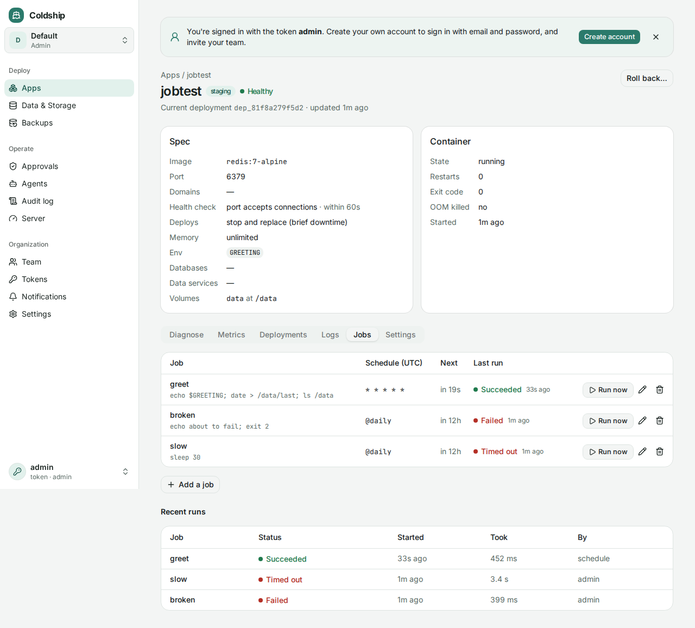

A job runs a command on a schedule: clean up old sessions every night, send a weekly digest, sync something every 15 minutes. Each run gets a fresh container from the image the app is running, with the same env, databases, data services and volumes, and is removed when it's done.



## Adding a job

```sh
coldship jobs set web cleanup --schedule '0 3 * * *' -- npm run cleanup
```

Or open the app in the dashboard, then **Jobs → Add a job**. Or put them in the spec:

```yaml
jobs:
  - name: cleanup
    schedule: "0 3 * * *"
    command: npm run cleanup
  - name: sync
    schedule: "*/15 * * * *"
    command: ./bin/sync --quiet
    timeout: 5m
```

Adding, changing or removing jobs doesn't redeploy the app: the plan's action is `config`, and the running container is left alone. For an app built from Git, the job runs the commit that's deployed, never a newer one.

- **schedule** is cron in UTC: `minute hour day month weekday`, like `0 3 * * *` (03:00 daily), `*/15 * * * *` (every 15 minutes) or `0 6 * * 1` (Mondays at 06:00). `@hourly`, `@daily`, `@weekly` and `@monthly` work too.
- **command** runs with `sh -c`, so the image needs a shell (distroless images don't have one).
- **timeout** stops a run that takes too long: 30 minutes by default, at most 24 hours.

## Runs

```sh
coldship jobs web                  # each job's schedule, next run and last result
coldship jobs run web cleanup      # run now (add --wait to wait and print its output)
coldship jobs logs web cleanup     # the last run's output
coldship jobs runs web             # recent runs
coldship jobs rm web cleanup
```

- A job never overlaps itself. If a run is still going when the next one is due, that one is recorded as **skipped**; running it by hand is refused until it's done.
- Runs missed while the server was down aren't caught up. A run cut off by a restart is marked **interrupted**.
- At most 4 jobs run at once on the server. Self-upgrades wait for running jobs.
- The last 50 runs of each job are kept, with the last 64 KB of output.
- A job runs in its own container, with the same memory limit as the app (its own limit, not a share of the app's), and the app doesn't have to be up for its jobs to run.
- Static sites have no image, so they can't have jobs. Previews don't run jobs.

## When a job fails

`job.failed` goes to your [notification channels](/guides/notifications/) the first time a job fails, with the end of its output, and `job.recovered` when it works again: a job failing every 15 minutes sends one message, not one per run. An [agent](/guides/agents-in-dashboard/#responding-to-alerts) can also start on `job.failed` to look into it.

## Agents

Agents list jobs with `coldship_jobs`, run them with `coldship_job_run` and read results with `coldship_job_runs` and `coldship_job_log`. They add or change jobs with `coldship_plan` and a patch (`set_jobs`, `remove_jobs`), then `coldship_apply`, like any other change.
