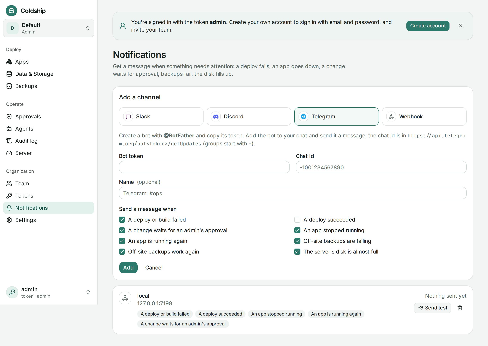

Coldship tells you when something needs attention, wherever your team already looks.



## Events

| Event | When | On by default (new channels) |
|---|---|---|
| `deploy.failed` | A deploy or build failed, a push couldn't be deployed, or a restart interrupted a deploy | yes |
| `deploy.succeeded` | A deploy finished | no |
| `approval.needed` | Someone (often an agent) tried to apply a destructive change to a production app; an admin has to approve it. Sent once per plan | yes |
| `app.down` | An app's container stopped running (two checks a minute apart, so a quick restart doesn't page you) | yes |
| `app.recovered` | It's running again | yes |
| `backup.failing` / `backup.recovered` | [Off-site backups](/guides/backups/) started failing, or work again | yes |
| `disk.low` | The server's disk is 90% full. Repeats at most daily; default organization only | yes |
| `agent.report` | An agent [started by an alert](/guides/agents-in-dashboard/#responding-to-alerts) reports what it found | yes |
| `agent.waiting` | An agent on an alert asks permission for a tool and waits for a person | yes |

Previews never notify: agents create and delete them all the time. Planning alone doesn't either; a plan is a dry run until someone applies it.

## Adding a channel

In the dashboard: **Organization → Notifications → Add channel**, pick the kind, paste the URL or token, choose the events, then **Send test**.

From the CLI (an admin token). The URL or token comes from the environment, or a hidden prompt, so it stays out of your shell history:

```sh
COLDSHIP_NOTIFY_URL=https://hooks.slack.com/services/T000/B000/XXXX coldship notify add slack --name "#ops"
COLDSHIP_NOTIFY_URL=https://discord.com/api/webhooks/123/abc coldship notify add discord
COLDSHIP_TELEGRAM_TOKEN=123456:ABC-DEF... coldship notify add telegram --chat-id -1001234567890
COLDSHIP_NOTIFY_URL=https://example.com/coldship coldship notify add webhook --events deploy.failed,app.down
coldship notify test <id>
```

- **Slack:** Apps → Incoming Webhooks → Add to Slack, pick a channel, copy the webhook URL.
- **Discord:** channel settings → Integrations → Webhooks → New Webhook → Copy Webhook URL.
- **Telegram:** create a bot with @BotFather and copy its token. Add the bot to your group or channel and send it a message, then open `https://api.telegram.org/bot<token>/getUpdates` to find the chat id (groups start with `-`).
- **Webhook:** any URL that accepts a JSON POST.

URLs and tokens are stored encrypted and never shown again; the dashboard shows only where a channel goes.

## Links

Set `--public-url` (or `COLDSHIP_PUBLIC_URL`) on the server, and each message links to the app, the approvals page or the backups page in the dashboard.

## Webhook payloads

Each event is POSTed as JSON:

```json
{
  "event": "deploy.failed",
  "org": "default",
  "app": "web",
  "deployment": "dep_a931de19da0c",
  "plan": "plan_3c2f…",
  "severity": "error",
  "title": "web: deploy failed",
  "detail": "health_check_failed: …",
  "actor": "admin",
  "link": "https://coldship.example.com/apps/web",
  "at": "2026-11-02T07:20:11Z"
}
```

Check the signature before trusting it. `X-Coldship-Signature` is `sha256=` followed by the hex HMAC-SHA256 of `X-Coldship-Timestamp + "." + body`, keyed with the signing secret shown once when the channel is added. Reject old timestamps to stop replays:

```python
import hashlib, hmac, time

def verify(secret: str, timestamp: str, body: bytes, signature: str) -> bool:
    if abs(time.time() - int(timestamp)) > 300:
        return False
    mac = hmac.new(secret.encode(), timestamp.encode() + b"." + body, hashlib.sha256).hexdigest()
    return hmac.compare_digest("sha256=" + mac, signature)
```

`X-Coldship-Event` names the event. Failed deliveries are retried twice, after 2 and 8 seconds; the last result shows on the channel.

`actor` names who caused the event, when someone did. Agent events also carry `agent_session`.

`title` and `detail` can include text from builds and apps (and agents' reports), so treat them as untrusted. Coldship escapes them for Slack, stops Discord mentions, and sends Telegram messages as plain text.

## Organizations

Each organization has its own channels and gets events about its own apps. Organizations other than the default one can only send to public HTTPS addresses.
