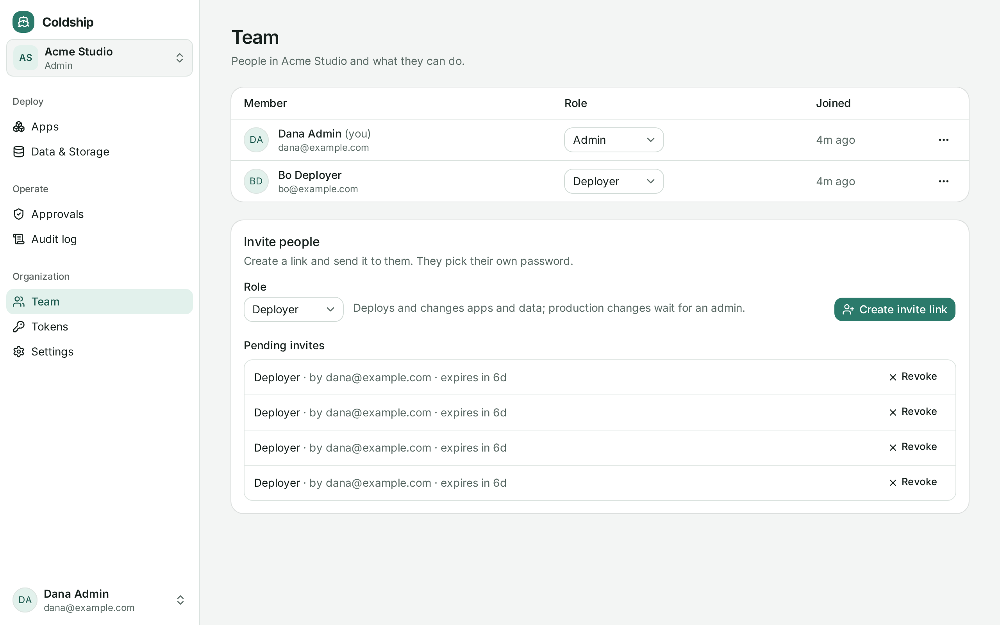

People sign in to the dashboard with their email and password. Tokens stay for the CLI, CI and AI agents.

## Your first account

The installer prints a link at the end:

```
  Your account:      http://127.0.0.1:7070/invite#…
```

Open it (through the SSH tunnel if the dashboard isn't public), pick your name, email and password, and you're an admin. The link works once, for 7 days. Missed it? Run `coldship invite` on the server for a new one, or sign in with the admin token and click **Create account**.

## Inviting people

In **Team**, choose a role and click **Create invite link**. Coldship doesn't send email: copy the link and send it however you like. It works once, within 7 days; pending invites can be revoked. Someone who already has an account joins with one click.

| Role | Can |
|---|---|
| **Admin** | Everything: approves production changes, manages members, tokens and settings |
| **Deployer** | Deploys and changes apps and data; production changes wait for an admin |
| **Viewer** | Sees apps, logs and metrics; changes nothing |



Roles are the same as [token scopes](/concepts/guardrails/#scoped-tokens) (`admin`, `deploy`, `read`). Changing someone's role or removing them applies at once, also to their open sessions. An organization always keeps at least one admin.

Forgot a password? An admin of the default organization opens the member's menu in **Team** and copies a **password reset link**. It works once, within 24 hours, and signs the person out everywhere else.

## Organizations

An organization holds apps, data services, tokens, members, its audit log and its own GitHub connection. Members of one see nothing of another: other organizations' apps don't exist for them, by any route, and an app can't use another organization's data service.

Switch between your organizations at the top of the sidebar. Admins of the **default** organization, which holds everything from before organizations existed, also run the server itself (upgrades, secrets, server status) and can create new organizations.

Tokens belong to the organization they were created in, so the CLI and agents act there:

```sh
coldship token create --name ci --scope deploy
```

App and data service names are unique across the server, since they name containers and domains.

### Moving an app

An admin of both organizations can move an app from its **Settings** tab. Its previews and own databases go along, and the containers keep running. An app that uses the organization's data services has to disconnect them first, so it never keeps credentials from an organization it left. Plans made before the move expire.

### Deleting an organization

**Settings → Delete organization** removes its members, tokens and invites once it has no apps or data services left. The default organization can't be deleted.
